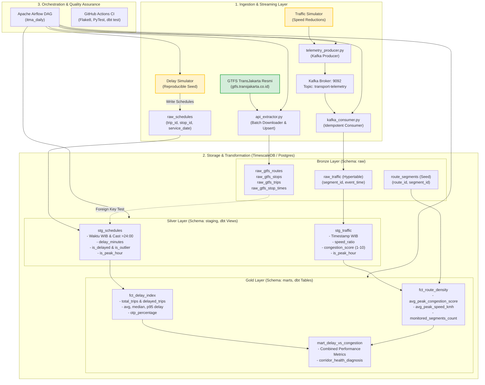

# 📖 ITMA: Indonesian Transport & Mobility Analytics
## Dokumen Arsitektur Teknis, Data Pipeline, dan Spesifikasi Analitik
**Versi: 1.2 · Status: Proyek portofolio (data sintetis, belum dideploy) · Penulis: arfan379**

---

## 1. Executive Summary

**Indonesian Transport & Mobility Analytics (ITMA)** adalah platform data engineering modern end-to-end yang dirancang untuk mengatasi tantangan keandalan transportasi massal di wilayah Jabodetabek. Sistem ini mengintegrasikan data statis jadwal TransJakarta resmi (*batch*) dengan aliran data telemetri kecepatan lalu lintas koridor (*streaming* berbasis Apache Kafka), mengolahnya menggunakan **dbt (data build tool)** dengan arsitektur **Medallion (Bronze, Silver, Gold)** di atas **PostgreSQL / TimescaleDB**, dan diorkestrasikan secara harian menggunakan **Apache Airflow**.

Tujuan strategis ITMA:
1. Menghitung indeks keterlambatan harian dan metrik **On-Time Performance (OTP)** per rute.
2. Menghitung **Route Congestion Score** (skor 1-10) pada jam sibuk perkotaan (06:00-09:00 dan 17:00-20:00 WIB).
3. Mengkorelasikan keterlambatan bus dengan titik kemacetan fisik jalan raya untuk menghasilkan diagnosa kesehatan koridor (*corridor health diagnosis*).

---

## 2. Arsitektur Sistem & Komponen



---

## 3. Spesifikasi Sumber Data & Provenance

### 3.1 Data Nyata vs Data Sintetis

| Domain Data | Sumber | Klasifikasi | Aturan Kepatuhan |
|---|---|---|---|
| **Rute, Halte, Trip, Jadwal Terencana** | Feed resmi GTFS TransJakarta (`https://gtfs.transjakarta.co.id/files/file_gtfs.zip`) | **Nyata (Real)** | Sesuai kebijakan data publik Pemprov DKI Jakarta. Data mentah tidak diperjualbelikan atau diredistribusi ulang. |
| **Waktu Kedatangan Aktual (`actual_arrival_time`)** | `src/simulator/delay_simulator.py` | **Sintetis (Synthetic)** | Wajib ditandai `is_synthetic = TRUE` di setiap tabel. |
| **Kecepatan Segmen Koridor (`speed_kmh`)** | `src/simulator/telemetry_producer.py` | **Sintetis (Synthetic)** | Wajib ditandai `is_synthetic = TRUE` di setiap payload Kafka dan tabel database. |

### 3.2 Penanganan Khusus Format Waktu GTFS (>24:00:00)
GTFS TransJakarta memuat jadwal untuk rute angkutan malam hari (Amari) yang merepresentasikan waktu setelah tengah malam dengan nilai $\ge 24:00:00$ (contoh: `25:10:00` untuk 01:10 WIB dini hari). 
- Di **Bronze**, kolom waktu disimpan sebagai tipe data `TEXT` untuk mencegah *cast exception*.
- Di **Silver (`stg_schedules`)**, parser memecah jam, menit, dan detik menggunakan interval aritmatika:
  $$\text{service\_date} + \text{INTERVAL} '1\text{ hour}' \times H + \text{INTERVAL} '1\text{ minute}' \times M + \text{INTERVAL} '1\text{ second}' \times S$$
  kemudian diubah ke zona waktu resmi `Asia/Jakarta` (`TIMESTAMPTZ`).

---

## 4. Arsitektur Medallion (Data Catalog)

### 4.1 Bronze Layer (Skema `raw`)
Tabel mentah hasil ekstraksi tanpa modifikasi logika bisnis.

| Nama Tabel | Deskripsi | Primary / Unique Key | Partisi / Hypertable |
|---|---|---|---|
| `raw.raw_gtfs_routes` | Daftar rute dan jenis trayek TransJakarta | `route_id` | Standar |
| `raw.raw_gtfs_stops` | Titik koordinat dan nama halte busway | `stop_id` | Standar |
| `raw.raw_gtfs_trips` | Nomor perjalanan per rute dan arah | `trip_id` | Standar |
| `raw.raw_gtfs_stop_times` | Urutan halte dan jadwal terencana | `(trip_id, stop_sequence)` | Standar |
| `raw.raw_schedules` | Kedatangan aktual bus hasil simulasi harian | `(trip_id, stop_id, service_date)` | Standar |
| `raw.raw_traffic` | Log pembacaan kecepatan kendaraan per segmen | `(segment_id, event_time)` | TimescaleDB Hypertable on `event_time` |
| `raw.route_segments` | Tabel seed pemetaan rute ke kode ruas jalan | `(route_id, segment_id)` | Standar (dbt Seed) |

### 4.2 Silver Layer (Skema `staging`)
View yang menstandardisasi tipe data, zona waktu WIB, dan mengkalkulasi metrik individual.

- **`staging.stg_schedules`**:
  - `delay_minutes`: Selisih waktu aktual terhadap jadwal terencana (dalam satuan menit).
  - `is_delayed`: `TRUE` jika `delay_minutes > 5.0`.
  - `is_outlier`: `TRUE` jika bus datang terlalu cepat secara tidak wajar (`delay_minutes < -30.0`).
  - `is_peak_hour`: `TRUE` jika kedatangan terjadi pada 06:00-08:59 WIB atau 17:00-19:59 WIB.
- **`staging.stg_traffic`**:
  - `speed_ratio`: Rasio kecepatan aktual terhadap kecepatan bebas hambatan ($\frac{\text{speed\_kmh}}{\text{free\_flow\_speed\_kmh}}$).
  - `congestion_score`: Pemetaan integer 1 (sangat lancar) hingga 10 (kemacetan total / gridlock).
  - `is_peak_hour`: Filter jam sibuk berbasis timestamp WIB.

### 4.3 Gold Layer (Skema `marts`)
Tabel fakta dan mart bisnis agregasi harian siap konsumsi analitik & dashboard BI.

- **`marts.fct_delay_index`**:
  - Agregasi harian per rute (`route_id`, `service_date`).
  - Metrik: `total_trips`, `delayed_trips`, `avg_delay_minutes`, `median_delay_minutes`, `p95_delay_minutes`, dan `otp_percentage`.
  - Filter: Mengecualikan record dengan `is_outlier = TRUE` agar metrik tidak bias.
- **`marts.fct_route_density`**:
  - Agregasi kepadatan lalu lintas koridor pada jam sibuk.
  - Metrik: `avg_peak_congestion_score`, `avg_peak_speed_kmh`, `avg_peak_speed_ratio`, `monitored_segments_count`.
- **`marts.mart_delay_vs_congestion`**:
  - Tabel analitik gabungan delay dan kemacetan jalan.
  - Kolom Diagnosa: `corridor_health_diagnosis`:
    - `Severe Delay Correlated with Congestion`: OTP $< 70\%$ dan skor macet $\ge 6.0$.
    - `Delay Likely Operational / Dispatch Issue`: OTP $< 70\%$ namun skor macet $< 6.0$.
    - `Resilient Corridor`: OTP $\ge 70\%$ meskipun skor macet tinggi ($\ge 6.0$).
    - `Healthy Service`: Koridor lancar dan bus tepat waktu.

---

## 5. Formulasi Aturan Bisnis & Metrik

1. **Perhitungan Delay Menit**:
   $$\text{delay\_minutes} = \frac{\text{EXTRACT}(\text{EPOCH FROM } (\text{actual\_arrival\_time} - \text{scheduled\_arrival\_time}))}{60}$$

2. **On-Time Performance (OTP)**:
   $$\text{OTP} = \left( \frac{\text{Total Trips} - \text{Delayed Trips}}{\text{Total Trips}} \right) \times 100\%$$
   *Di mana trip diklasifikasikan terlambat jika ada minimal satu halte dengan $\text{delay\_minutes} > 5.0$.*

3. **Congestion Score (1-10)**:
   $$\text{congestion\_score} = \min\left(10, \max\left(1, \text{ROUND}\left(10 - \frac{\text{speed\_kmh}}{\text{free\_flow\_speed\_kmh}} \times 9\right)\right)\right)$$

---

## 6. Jaminan Kualitas Data & Pengujian (Quality Matrix)

ITMA menerapkan pengujian bertingkat (*multi-layer verification*):

### 6.1 PyTest Suite (17 Unit Tests — 100% PASS)
- `test_gtfs_parser.py`: Pengujian parser format waktu normal, waktu lewat tengah malam (`25:10:00`), validasi kelengkapan berkas ZIP GTFS, dan ekstraksi `feed_version`.
- `test_simulator.py`: Pengujian determinisme seed harian (reproducible), distribusi delay jam sibuk vs luar jam sibuk, injeksi insiden, schema validasi event Kafka, dan deteksi outlier.
- `test_airflow_dag.py`: Pengujian integritas DAG Airflow, schedule `@daily`, ketiadaan siklus berulang (Acyclic DFS check), dan keterurutan rantai dependensi task.

### 6.2 dbt Data Quality Tests (46 Data Tests — 100% PASS)
- **Relationships Tests**: Memvalidasi integritas referensial foreign key (`stg_schedules.route_id` harus ada di `raw.raw_gtfs_routes`).
- **Accepted Range Tests**:
  - `delay_minutes` berada pada rentang valid $[-120, 300]$.
  - `congestion_score` berada pada rentang integer $[1, 10]$.
  - `speed_ratio` berada pada rentang $[0, 2]$.
  - `otp_percentage` berada pada rentang $[0, 100]$.
- **Uniqueness & Non-Null**: Kombinasi kunci unik `(trip_id, stop_id, service_date)` dan `(segment_id, event_time_wib)`.

### 6.3 Code Quality & Linter
- **Flake8**: 0 error / 0 warning pada seluruh berkas di `src/`, `tests/`, dan `dags/` dengan batas panjang baris 120 karakter.

---

## 7. Panduan Pengoperasian (Runbook)

### 7.1 Menyalakan Infrastruktur
```bash
docker compose up -d postgres kafka kafka-init
```

### 7.2 Eksekusi Manual Pipeline
```bash
source .venv/bin/activate

# 1. Unduh GTFS Resmi
python src/ingestion/api_extractor.py

# 2. Jalankan Delay Simulator
python src/simulator/delay_simulator.py --date $(date +%Y-%m-%d)

# 3. Jalankan Traffic Producer ke Kafka
python src/simulator/telemetry_producer.py --date $(date +%Y-%m-%d)

# 4. Konsumsi Kafka ke TimescaleDB
python src/ingestion/kafka_consumer.py

# 5. Jalankan dbt Seed, Run, dan Test
cd transform
dbt seed --profiles-dir .
dbt run --profiles-dir .
dbt test --profiles-dir .
```

### 7.3 Melihat Visualisasi Lineage dbt
```bash
cd transform
dbt docs generate --profiles-dir .
dbt docs serve --profiles-dir . --port 8081
```
Buka browser pada alamat `http://localhost:8081`.

---

## 8. Spesifikasi Target Deployment Cloud (Terraform IaC)

File [infra/terraform/main.tf](infra/terraform/main.tf) menyediakan blueprint infrastruktur produksi di Google Cloud Platform (Region Jakarta `asia-southeast2`):
- **VPC & Subnet Private**: Jaringan terisolasi untuk transmisi data telemetri.
- **Cloud Storage Bucket**: Penyimpanan arsip file GTFS terversi dengan siklus hidup penghapusan otomatis 90 hari.
- **Cloud SQL PostgreSQL (TimescaleDB Ready)**: Instance database terkelola dengan flag `shared_preload_libraries = timescaledb` dan konfigurasi backup otomatis.
