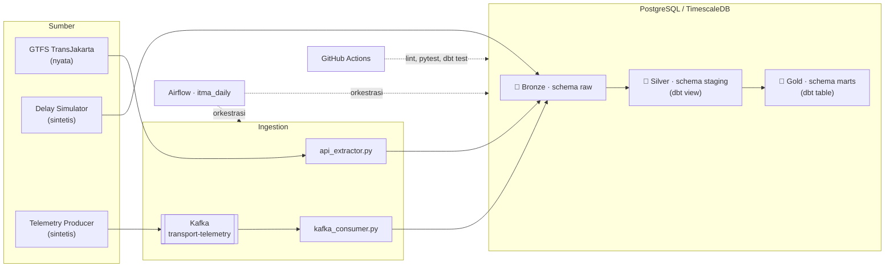

# 🚌 ITMA: Indonesian Transport & Mobility Analytics

[](https://github.com/arfan379/itma/actions/workflows/ci.yml)


Proyek portofolio **data engineering** end-to-end: pipeline batch + streaming untuk menganalisis
keandalan layanan bus TransJakarta, dengan arsitektur **Medallion (Bronze → Silver → Gold)**.

> [!IMPORTANT]
> **Tentang data.** Hanya *jadwal terencana* (GTFS) yang berasal dari sumber resmi.
> **Waktu kedatangan aktual bus** dan **kecepatan lalu lintas** adalah **data sintetis** hasil simulator
> (ditandai `is_synthetic = TRUE` di setiap baris). Proyek ini menunjukkan **cara membangun pipeline**,
> bukan temuan nyata tentang kemacetan Jakarta. Lihat [Batasan](#batasan-yang-diketahui).

---

## 🎯 Pertanyaan yang Ingin Dijawab

1. Seberapa **tepat waktu** tiap rute per hari? (*On-Time Performance* / OTP)
2. Seberapa **macet** ruas jalan yang dilalui rute itu saat jam sibuk? (skor 1–10)
3. Jika bus telat, apakah **sejalan dengan kemacetan**, atau lebih mungkin masalah operasional?

## 🏛️ Arsitektur



| Layer | Schema | Isi | Dibuat oleh |
|---|---|---|---|
| 🥉 Bronze | `raw` | Data mentah apa adanya: `raw_gtfs_*`, `raw_schedules`, `raw_traffic`, seed `route_segments` | Python + `init_db.sql` |
| 🥈 Silver | `staging` | Dibersihkan: zona waktu WIB, `delay_minutes`, flag `is_delayed` / `is_outlier` / `is_peak_hour`, `congestion_score` | dbt (view) |
| 🥇 Gold | `marts` | Agregasi siap analisis: `fct_delay_index`, `fct_route_density`, `mart_delay_vs_congestion` | dbt (table) |

## 🧰 Tech Stack

| Kebutuhan | Teknologi |
|---|---|
| Bahasa | Python 3.12, SQL |
| Streaming | Apache Kafka (Zookeeper) |
| Database | PostgreSQL 15 + TimescaleDB (hypertable untuk `raw_traffic`) |
| Transformasi & data testing | dbt (`dbt-postgres`, `dbt_utils`) |
| Orkestrasi | Apache Airflow 2.8 (LocalExecutor) |
| Container | Docker, Docker Compose |
| Kualitas kode | pytest, flake8, GitHub Actions |
| IaC (draft) | Terraform (GCP) |

## 📊 Sumber Data

| Data | Sumber | Tipe |
|---|---|---|
| Rute, halte, trip, jadwal terencana | Feed GTFS resmi PT Transportasi Jakarta (URL di `.env.example`) | **Nyata** |
| `actual_arrival_time` | `src/simulator/delay_simulator.py` | **Sintetis** |
| `speed_kmh` per ruas jalan | `src/simulator/telemetry_producer.py` | **Sintetis** |
| Pemetaan rute → ruas jalan | `transform/seeds/route_segments.csv` | **Contoh** (dibuat manual, bukan peta resmi) |

Data GTFS mentah tidak dipublikasikan ulang di repositori ini.

## 📐 Aturan Bisnis

```text
delay_minutes   = (actual_arrival - scheduled_arrival) dalam menit
is_delayed      = delay_minutes > 5
is_outlier      = delay_minutes < -30        -> dikeluarkan dari agregasi Gold, tetap ada di Silver
trip terlambat  = minimal 1 halte pada trip itu is_delayed
OTP (%)         = (total_trips - delayed_trips) / total_trips * 100
jam sibuk (WIB) = 06:00-08:59 dan 17:00-19:59
congestion      = clamp( round(10 - speed / free_flow_speed * 9), 1, 10 )
```

Diagnosis koridor di `mart_delay_vs_congestion`:

| Kondisi | `corridor_health_diagnosis` |
|---|---|
| OTP < 70% dan macet ≥ 6 | Severe Delay Correlated with Congestion |
| OTP < 70% dan macet < 6 (atau tidak ada data) | Delay Likely Operational / Dispatch Issue |
| OTP ≥ 70% dan macet ≥ 6 | Resilient Corridor (High Traffic but Maintained OTP) |
| lainnya | Healthy Service |

**Jadwal lewat tengah malam:** GTFS boleh menulis `25:10:00` (= 01:10 hari berikutnya). Kolom waktu
disimpan sebagai `TEXT` di Bronze, lalu di Silver diparse lewat aritmetika interval dari `service_date`.

## 🚀 Cara Menjalankan

### Prasyarat
Docker + Docker Compose, Python 3.12.

### Opsi A: Cepat, tanpa Airflow (disarankan untuk mencoba)

```bash
# 1. Infrastruktur: PostgreSQL/TimescaleDB, Zookeeper, Kafka
cp .env.example .env
docker compose up -d postgres kafka kafka-init

# 2. Lingkungan Python
python3 -m venv .venv && source .venv/bin/activate
pip install -r requirements.txt

# 3. Bronze: isi tabel GTFS
#    a) feed sintetis kecil (offline, cepat, dipakai juga oleh CI):
python -m src.ingestion.sample_gtfs --out /tmp/sample_gtfs.zip
python src/ingestion/api_extractor.py --zip-path /tmp/sample_gtfs.zip
#    b) atau feed resmi TransJakarta:
# python src/ingestion/api_extractor.py

# 4. Bronze: simulasi keterlambatan & telemetri
D=$(date +%Y-%m-%d)
python src/simulator/delay_simulator.py --date $D
python src/simulator/telemetry_producer.py --date $D     # kirim ke Kafka
python src/ingestion/kafka_consumer.py                   # Kafka -> raw.raw_traffic

# 5. Silver + Gold dengan dbt
cd transform
dbt deps  --profiles-dir .
dbt seed  --profiles-dir .
dbt run   --profiles-dir .
dbt test  --profiles-dir .
dbt docs generate --profiles-dir . && dbt docs serve --profiles-dir . --port 8081
```

### Opsi B: Semua otomatis dengan Airflow

```bash
cp .env.example .env        # di Linux, isi AIRFLOW_UID dengan hasil `id -u`
docker compose up -d --build
# Airflow UI: http://localhost:8080  (admin / admin, hanya untuk lokal)
# DAG: itma_daily  ->  aktifkan lalu Trigger
```

`Dockerfile.airflow` menambahkan dbt (di virtualenv terpisah), `kafka-python`, dan `numpy` ke image Airflow.

DAG `itma_daily` berjalan berurutan:

```text
ingest_gtfs -> run_delay_simulator -> run_telemetry_producer -> run_kafka_consumer
            -> dbt_deps -> dbt_seed -> dbt_run -> dbt_test -> dbt_docs_generate
```

### Melihat hasil

```sql
SELECT route_id, total_trips, otp_percentage, avg_peak_congestion_score, corridor_health_diagnosis
FROM marts.mart_delay_vs_congestion
ORDER BY route_id;
```

## ✅ Kualitas & Pengujian

| Lapisan | Alat | Cakupan |
|---|---|---|
| Unit test | pytest (21 tes) | parser GTFS (termasuk `>24:00`), feed sampel, simulator (seed reproducible, jam sibuk vs non-sibuk), validasi event Kafka, integritas DAG (tanpa siklus, urutan task, pemakaian `DBT_BIN`) |
| Data test | dbt (46 tes) | `unique_combination_of_columns`, `not_null`, `accepted_range` (delay, congestion, speed_ratio, OTP), `relationships` (`route_id` ke `raw_gtfs_routes`) |
| Lint | flake8 (`src/ tests/ dags/`, maks. 120 kolom) | gaya kode |
| CI | GitHub Actions | lint → pytest → dbt seed/run/test pada Postgres sungguhan |

## 🧠 Keputusan Desain

- **Idempotent.** Semua loader memakai `INSERT ... ON CONFLICT DO UPDATE`, jadi aman dijalankan ulang tanpa duplikat.
- **Simulasi reproducible.** Seed dihitung dari `seed_base` + tanggal layanan, sehingga hari yang sama menghasilkan data yang sama.
- **Transparansi data.** Flag `is_synthetic` ada di Bronze dan Silver.
- **Outlier tidak dihapus.** Hanya dikeluarkan dari agregasi Gold, supaya jejak audit tetap ada.
- **Nama skema eksplisit.** `transform/macros/generate_schema_name.sql` membuat skema bernama persis `raw` / `staging` / `marts`.
- **Validasi di tepi.** Event Kafka dan baris GTFS yang tidak valid ditolak dan dihitung (`rejected`), bukan membuat pipeline gagal.

## 📂 Struktur Repositori

```text
itma/
├── docker-compose.yml          # Postgres/TimescaleDB, Zookeeper, Kafka, Airflow
├── Dockerfile.airflow          # Image Airflow + dbt + kafka-python + numpy
├── .env.example
├── .github/workflows/ci.yml    # lint, pytest, dbt run & test
├── infra/
│   ├── init_db.sql             # skema raw/staging/marts + tabel Bronze + hypertable
│   └── terraform/main.tf       # DRAFT IaC GCP (belum di-apply)
├── src/
│   ├── ingestion/
│   │   ├── api_extractor.py    # GTFS -> Bronze (upsert)
│   │   ├── sample_gtfs.py      # feed GTFS sintetis untuk CI/dev
│   │   └── kafka_consumer.py   # Kafka -> raw.raw_traffic
│   └── simulator/
│       ├── config.yml          # parameter simulasi
│       ├── delay_simulator.py  # actual_arrival_time sintetis
│       └── telemetry_producer.py
├── transform/                  # proyek dbt
│   ├── macros/generate_schema_name.sql
│   ├── seeds/route_segments.csv
│   └── models/{staging,marts}/
├── dags/itma_daily.py          # DAG Airflow
└── tests/
```

## Batasan yang Diketahui

Dicatat terbuka agar tidak salah ditafsirkan:

1. **Korelasi macet-telat bukan temuan nyata.** Delay bus dan kecepatan jalan disimulasikan *terpisah*;
   keduanya hanya sama-sama memburuk di jam sibuk. Mart ini mendemonstrasikan *pipeline* analisisnya,
   bukan hubungan sebab-akibat.
2. **Parameter simulator terlalu keras.** Pada data contoh, OTP rute hanya 0–25% sehingga hampir semua
   rute mendapat diagnosis yang sama. Parameter di `src/simulator/config.yml` perlu dikalibrasi agar
   distribusinya lebih bervariasi.
3. **Belum diuji penuh dengan feed GTFS resmi.** `route_segments.csv` adalah pemetaan contoh; ID rute di
   feed resmi bisa berbeda.
4. **Kegagalan Kafka tidak menghentikan pipeline.** `telemetry_producer` hanya mencatat warning, sehingga
   data lalu lintas bisa kosong tanpa error yang jelas di Airflow.
5. **Terraform masih draft.** Belum pernah di-apply. Cloud SQL standar tidak menyediakan ekstensi
   TimescaleDB, jadi konfigurasinya perlu disesuaikan sebelum dipakai nyata.
6. **Kredensial default** (`itma_password`, `admin/admin`) hanya untuk pengembangan lokal.

## 🗺️ Pengembangan Selanjutnya

- Kalibrasi simulator + hubungkan delay dengan kecepatan jalan secara eksplisit (model sebab-akibat).
- Ganti simulator dengan data nyata (mis. GTFS-Realtime) bila tersedia.
- Dashboard BI di atas schema `marts`.
- Strict mode untuk producer Kafka dan alerting kegagalan di Airflow.
- Validasi dan *apply* Terraform ke lingkungan nyata.

---

Dibuat oleh [**arfan379**](https://github.com/arfan379) sebagai proyek portofolio data engineering.
